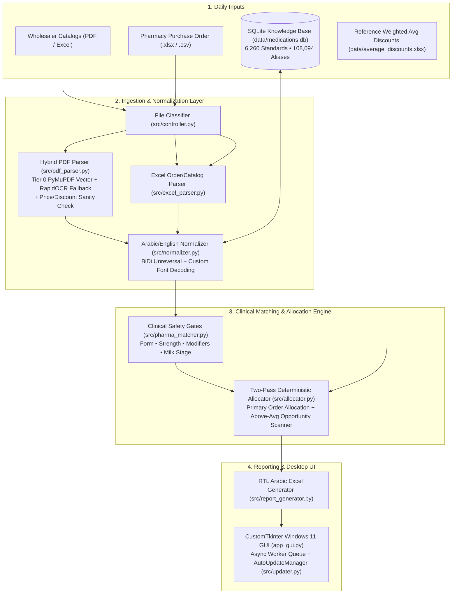

# 📜 Project History & Developer Onboarding Guide (`PROJECT_HISTORY.md`)

Welcome to the **Egyptian Pharma Procurement Optimizer (`نظام المشتريات الصيدلانية الأمثل`)** repository. This document provides a complete architectural and historical overview so that any new engineer joining the project can quickly understand **why** the system is designed the way it is, **what** domain edge cases it solves, and **how** it evolved from `v1.0.0` to `v2.0`.

---

## 1. Domain Context & Problem Statement

Community and hospital pharmacies in Egypt purchase daily stock from dozens of pharmaceutical wholesalers (`مخازن الأدوية`, e.g., *Ibn Sina*, *Al-Motahedon*, *Al-Fares*, *Al-Hadhaba*, *Cure*, *Adam Farm*, *Al-Dawlia Al-Haditha*, etc.). Every day:
1. Wholesalers broadcast updated **PDF or Excel price catalogs** via WhatsApp/Telegram containing thousands of items, official public prices (`سعر الجمهور`), and daily cash/credit discount percentages (`نسبة الخصم %`).
2. The pharmacy exports a **purchase order / shortage sheet (`كشف النواقص / الطلبية`)** from its ERP/POS system listing needed medications and quantities.

**Why manual comparison fails:**
- Wholesaler PDFs are generated by diverse, legacy Arabic accounting systems (*ArwaSoft*, *OrgaSoft*, custom Crystal Reports, scanned faxes) with broken Arabic encodings, reversed right-to-left (RTL) character streams, custom font glyphs, multi-column layouts, and occasionally swapped Price/Discount columns.
- Matching drug names purely by fuzzy text similarity is **clinically dangerous** (e.g., matching *Augmentin 1g Tab* to *Augmentin 600mg Vial* or *Bebelac 1* to *Bebelac 2*).

**What this application does:**
- Ingests any combination of PDF/Excel wholesaler catalogs and pharmacy order sheets.
- Normalizes and resolves Arabic & English drug names through a **SQLite Medication Knowledge Base (`data/medications.db`)** and **4-gate clinical safety verifier (`src/pharma_matcher.py`)**.
- Allocates each requested item to the wholesaler offering the **maximum valid discount**, while also surfacing **per-warehouse above-average discount opportunities** against a reference weighted average discount baseline (`أرصدة المخازن / خصم مرجح`).
- Outputs ready-to-send, RTL-formatted Arabic Excel workbooks (`أفضل_اسعار_YYYY-MM-DD.xlsx` and `Procurement_Order_Optimized_YYYY-MM-DD.xlsx`).

---

## 2. System Architecture & Module Map



### Core Modules in `src/`
| Module | Responsibility |
| :--- | :--- |
| [`src/normalizer.py`](src/normalizer.py) | Arabic & English text normalization, RTL/BiDi unreversal (`unreverse_arabic_text`), custom ERP glyph decoding (`AL_HADABA_FONT_MAP`, `decode_greek_arwasoft`), ArwaSoft reversed Eastern Arabic number fixing, dosage/pack parsing, and catalog noise filtering (`is_catalog_noise`). |
| [`src/pdf_parser.py`](src/pdf_parser.py) | High-speed PyMuPDF vector table/coordinate parser with RapidOCR/RapidTable fallback, specialized extractors for 2-column/3-column ArwaSoft & Sina layouts, and multi-signal **Price/Discount inversion sanity checks**. |
| [`src/excel_parser.py`](src/excel_parser.py) | Reads pharmacy purchase orders (including multi-table stacked daily sheets) and Excel wholesaler catalogs with dynamic header detection and quantity aggregation. |
| [`src/medication_db.py`](src/medication_db.py) | SQLite-backed repository (`data/medications.db`) mapping 108,000+ raw/reversed/misspelled catalog aliases to 6,260 canonical medication entities in $O(1)$ memory lookup time. Includes automatic `LocalAppData` synchronization and read-only URI fallback. |
| [`src/pharma_matcher.py`](src/pharma_matcher.py) | Enforces strict clinical safety gates (`is_safe_pharmaceutical_match`): blocks mismatches across dosage forms, concentrations/strengths, release modifiers (`XR`, `SR`, `Plus`, `Extra`), and infant formula stages (`1`, `2`, `3`). |
| [`src/average_discounts.py`](src/average_discounts.py) | Loads the reference weighted average discount baseline (`data/average_discounts.xlsx`, 4,751 items) used to identify high-margin stock opportunities. |
| [`src/allocator.py`](src/allocator.py) | `MedicineAllocator`: executes deterministic two-pass allocation (exact canonical brand + safe fuzzy fallback) to maximize discounts per ordered item, and computes per-warehouse above-average discount tables. |
| [`src/report_generator.py`](src/report_generator.py) | Generates multi-sheet RTL Arabic Excel workbooks with live Excel `SUM` accounting formulas, KPI summary cards, per-warehouse purchase order sheets, and color-coded secondary opportunity tables. |
| [`src/controller.py`](src/controller.py) & [`src/pipeline.py`](src/pipeline.py) | Thread-safe bridge between GUI/CLI and core engine; handles file classification (`classify_files`), caching (`global_catalog_cache`), and output directory permission validation. |
| [`src/updater.py`](src/updater.py) | Silent background Wi-Fi auto-updater querying GitHub Releases API, downloading new `Setup_vX.Y.exe` installers to `%TEMP%`, and executing seamless non-admin in-place upgrades. |
| [`app_gui.py`](app_gui.py) | Modern Windows 11 CustomTkinter desktop GUI with async OCR/inspection queues, interactive file cards, and `--self-test` mode. |

---

## 3. Chronological Evolution (`v1.0.0` $\rightarrow$ `v2.0`)

### **v1.0.0 (September 2026) — Initial Deterministic Allocator**
- Built the initial two-pass procurement allocator (`src/allocator.py`) and clinical safety gates (`src/pharma_matcher.py`) to match pharmacy orders against major Egyptian wholesaler catalogs (*Al-Motahedon*, *Ibn Sina*, *Soficopharm*, *Al-Fares*).

### **v1.1.0 – v1.1.2 (September 2026) — Local ONNX OCR, Async UI & Permission Safety**
- Integrated local CPU **RapidOCR** and **RapidTable** (`ONNX Runtime`) so scanned PDF price lists could be parsed offline without external cloud APIs.
- Moved file inspection to background threads (`src/controller.py`) and added write-permission guards (`src/pipeline.py`) preventing crashes when installed under `Program Files` by automatically redirecting outputs to `~/Desktop/Pharma_Output` or `~/Documents/Pharma_Output`.

### **v1.1.3 (September 2026) — Tier 0 Vector Fast Path & File Lock Resilience**
- **Tier 0 Fast Path**: Detected digital vector PDFs (`len(page.get_text("words")) >= 10`) to bypass rasterization/OCR completely, cutting catalog parse times from minutes to `<500ms`.
- Added `is_catalog_noise()` to strip wholesaler phone numbers, tax IDs (`س.ت`, `ب.ض`), and software footers (*OrgaSoft*, *ArwaSoft*).
- Fixed Windows file handle locks (`[WinError 32]`) by wrapping all PyMuPDF `Document` objects in `finally: doc.close()` blocks.

### **v1.1.4 – v1.1.5 (September 2026) — ERP Font Decoding, BiDi Reversal & Multi-Line Unzipping**
- **Multi-Line Cell Unzipping**: Handled borderless PDFs (e.g., *Al-Forsan*) where PyMuPDF merged multiple rows into `\n`-separated cells, with wrap-continuation detection so long drug names aren't split into fake rows.
- **0% Net Pricing (`صافي`)**: Added support for essential medicines sold at 0% discount (`is_explicit_zero_discount`) without admitting blank/corrupted cells.
- **Custom ERP Font Decoding**: Mapped custom Aboriginal/Runic glyphs (`AL_HADABA_FONT_MAP`, e.g., `ﻟᣌᢔᡧ` $\rightarrow$ `لبن`) and ArwaSoft Greek glyphs back into standard Arabic.
- **Smart Arabic BiDi Reversal (`is_arabic_text_reversed`)**: Built token-scoring heuristics (`REVERSED_PHARMA_TOKENS` vs `FORWARD_PHARMA_TOKENS`) to unreverse backward PDF text streams (`لوسغ ورت دلوج` $\rightarrow$ `جولد ترو غسول`) while leaving natural forward Arabic untouched.

### **v1.7 (October 2026) — SQLite Medication Knowledge Base (`data/medications.db`)**
- Introduced `MedicationDB` (`src/medication_db.py`) and `scripts/build_medication_db.py` to decouple **static clinical identity** from **daily fluctuating discounts**.
- Pre-populated `data/medications.db` with thousands of canonical standards and over 100,000 raw, reversed, and OCR-split aliases from real training catalogs and purchase orders, achieving sub-millisecond $O(1)$ resolution and 135-item deterministic allocation parity.

### **v1.8 (October 2026) — Reference Weighted Average Discounts & Background Auto-Updater**
- Added `src/average_discounts.py` and bundled `data/average_discounts.xlsx` (4,751 reference items with `خصم مرجح`).
- Added `src/updater.py` (`AutoUpdateManager`) to check GitHub Releases silently in the background over Wi-Fi, download the latest installer to `%TEMP%`, and surface a one-click **"🚀 إعادة التشغيل والتحديث / Restart & Update"** button in the toolbar.

### **v1.9 (October 2026) — Per-Warehouse Secondary Opportunity Tables & Color Coding**
- Replaced the standalone above-average discount sheet with **per-warehouse secondary tables** integrated directly below the primary purchase order on each supplier's sheet (`طلب شراء - [اسم المخزن]`).
- Enforced a dual commercial filter: items appear in the secondary table if and only if:
  1. `Warehouse Discount - Reference Weighted Average Discount >= 4.0%`, **AND**
  2. `Unit Saving = Base Price * (Warehouse Discount - Reference Weighted Average Discount) >= 4.00 EGP`.
- Added visual competitive highlighting on Column 8 (`المخزن صاحب أعلى خصم`): **Soft Green (`#E2EFDA`)** when the current warehouse offers the highest discount market-wide, and **Soft Yellow (`#FFF2CC`)** showing the competing warehouse name and discount when another supplier is higher.

### **v2.0 – v2.1 (October 2026) — Price/Discount Inversion Sanity Checks, 3-Column ArwaSoft Rect Extractor, Failed OCR Archival & Expanded Knowledge Base**
- **Root Problems Solved**:
  1. Some wholesaler ArwaSoft catalogs (such as `شركة مخزن الدولية الحديثة للادوية د/محمود`) invert the positions of **Price (`السعر`)** and **Discount (`الخصم`)** (`[السعر | الخصم | إسم الصنف]` instead of `[الخصم | السعر | إسم الصنف]`), and omit headers on continuation pages 2–6.
  2. 3-column ArwaSoft catalogs (such as **Zahra Pharm / `تحديث زهره.pdf`**) draw a vector bounding rectangle around each item row (`width ≈ 181.6 pt, height ≈ 14.2 pt`) without internal vertical cell borders. PyMuPDF's `page.find_tables()` returned `0` tables, causing the parser to fall back to the 2-column `_extract_dar_fouad_columns()` extractor, which cut across Column 2 names and produced only 5 corrupted items out of 1,167.
  3. The legacy `RapidOCR` + `RapidTable` feature never worked on Arabic catalogs because `rapidocr_onnxruntime` bundles PaddleOCR's Chinese/English model (`ch_PP-OCRv4_rec_infer.onnx`), which lacks Arabic character support and always returned 0 Arabic items before falling back to digital parsing.
- **3-Column ArwaSoft Row-Rectangle Extractor (`_extract_arwasoft_3col_rects`)**:
  - Added vector rectangle inspection via `page.get_drawings()` to detect 3-column ArwaSoft row boxes, partition each box into local horizontal offsets (`Discount: [x0, x0+32)`, `Price: [x0+32, x0+67)`, `Item Name: [x0+67, x1]`), reconstruct multi-line wrapped names, unreverse ArwaSoft Eastern Arabic numerals, and extract all **1,167 items** across all 9 pages of `تحديث زهره.pdf`.
- **Archival of Failed OCR Feature (`archive/failed_ocr_feature/`)**:
  - Archived the legacy `RapidOCR` + `RapidTable` implementation and tests into `archive/failed_ocr_feature/` (`README_FAILED_OCR.md`, `legacy_ocr_parser.py`, `test_ocr_parser.py`), marked it as **FAILED / ARCHIVED**, removed the broken OCR button from `app_gui.py`, and stripped unused ONNX model bundling from `build_exe.py`.
- **4-Signal Sanity Check Architecture (`src/pdf_parser.py`)**:
  - Implemented batch/column-level (`_should_swap_price_and_discount`) and per-item row-level (`_sanity_check_item_price_and_discount`) sanity checks across merged single-cell tables, standard multi-column tables, and 2-column/3-column ArwaSoft coordinate layouts.
  - Combines header X-coordinate/text order detection, pharmaceutical discount upper bounds (`> 85%`), inline public price hints extracted from drug names (`extract_inline_price_hint`, e.g., `سعر 144`, `41.5ج`), and numeric distribution heuristics.
- **2-Column ArwaSoft & Arabic Decimal Enhancements**:
  - Reconstructed right-column RTL word order with sub-word glyph stitching (`gap <= 1.5 pt`), expanded Y-bounds (`88 < Y < 795`) to capture top rows, preserved Arabic decimal separators (`٫`, `U+066B`) before word splitting, and added table-level reversal voting (`is_table_reversed`).
- **Expanded `medications.db`**:
  - Added `شركة مخزن الدولية الحديثة للادوية.pdf` (529 items) and `تحديث زهره.pdf` (`زهرة فارم`, 1,167 items) to `input/catalogs/` and ingested all standards and aliases into `data/medications.db` (**6,842 standards**, **117,753 aliases**), with automatic version/size sync to `%LOCALAPPDATA%\EgyptianPharmaOptimizer\data\medications.db`.

---

## 4. Key Engineering Invariants ("What Every New Dev Must Know")

1. **Never Weaken Clinical Safety Gates (`src/pharma_matcher.py`)**:
   - A high fuzzy text score must **never** override a mismatch in dosage form (`قرص` vs `شراب` vs `امبول` vs `كريم`), concentration (`500مجم` vs `1000مجم`), or infant milk stage (`1` vs `2`).
2. **Never Wipe `data/medications.db` with `rebuild_fresh=True`**:
   - `data/medications.db` contains historical aliases from purchase orders that are no longer stored in the repository. When adding a new catalog, always open `MedicationDB()` and call `ingest_item_strings(db, items, source_label=...)` from `scripts/build_medication_db.py`, then run `PRAGMA wal_checkpoint(TRUNCATE);`.
3. **Preserve `train/` Benchmark Count (23 PDFs)**:
   - The benchmark test suites (`tests/test_challenger_m1_2.py`, `tests/test_full_train_benchmark.py`) assert `len(pdf_files) == 23` inside `train/`. Place new sample/production catalogs in `input/catalogs/` rather than `train/`.
4. **Eastern Arabic Digits (`\u0660-\u0669`) Live Inside `\u0600-\u06ff`**:
   - In Python regular expressions, `\u0600-\u06ff` includes Eastern Arabic digits `٠-٩`. Always translate `EASTERN_ARABIC_DIGITS` and normalize `٫` (`U+066B`) to `.` before running letter-digit decoupling regexes.

---

## 5. Developer Workflow Cheat Sheet

### Run Automated Tests
```powershell
# Core verification & regression suites
python -m pytest tests/test_v20_verification.py tests/test_v19_verification.py tests/test_challenger_m1_normalizer.py tests/test_challenger_m1_2.py tests/test_pdf_parser_adversarial.py -v

# Headless GUI self-test
python app_gui.py --self-test
```

### Ingest a New Catalog into `data/medications.db`
```powershell
python -c "from src.pdf_parser import PDFCatalogParser; from src.medication_db import MedicationDB; from scripts.build_medication_db import ingest_item_strings; df = PDFCatalogParser('input/catalogs/NEW_CATALOG.pdf').parse(); db = MedicationDB(); ingest_item_strings(db, df['item_name'].dropna().unique().tolist(), 'Catalog_NEW'); conn = db._connection().__enter__(); conn.execute('PRAGMA wal_checkpoint(TRUNCATE);'); conn.close()"
```

### Build Executable & Windows Installer
```powershell
# 1. Build standalone folder in dist/EgyptianPharmaOptimizer/
python build_exe.py

# 2. Compile Setup installer in dist_installer/EgyptianPharmaOptimizer_Setup_v2.0.exe
& "C:\Users\omart\AppData\Local\Programs\Inno Setup 6\ISCC.exe" installer.iss
```
