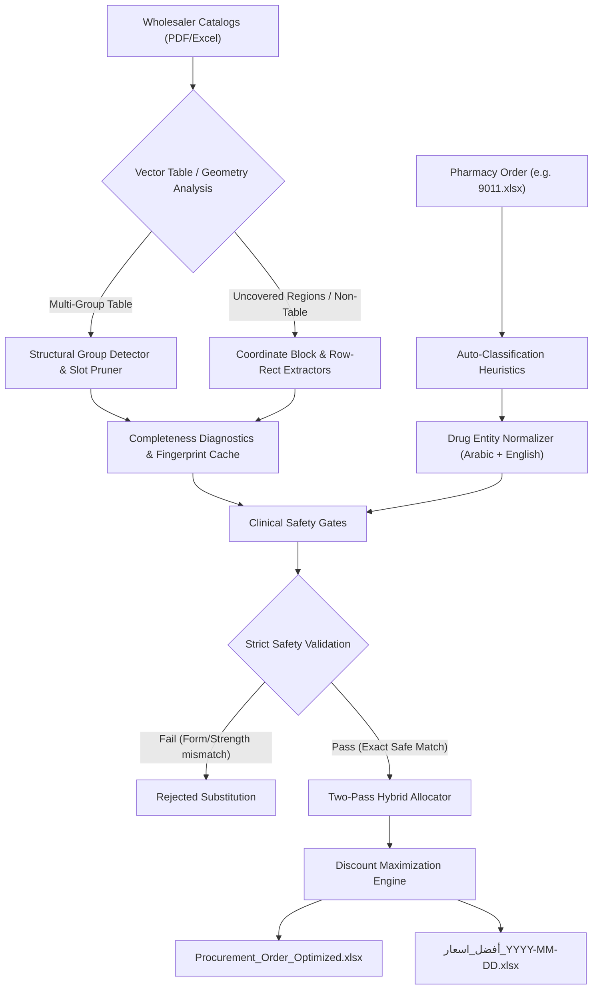

# 🏥 Egyptian Pharma Procurement Optimizer (نظام المشتريات الصيدلانية الأمثل)
**Version:** 2.5 (Production Windows Release)  
**Platform:** Windows 10 / 11 (64-bit) & Cross-Platform Python  

An intelligent, automated procurement optimization desktop application designed specifically for Egyptian community and hospital pharmacies. It ingests daily pharmaceutical wholesaler price lists (PDF and Excel catalogs), matches medicine orders with strict clinical safety validation, maximizes commercial discounts per item, and generates professionally formatted Arabic Excel purchase orders (`أفضل_اسعار_YYYY-MM-DD.xlsx` and `Procurement_Order_Optimized_YYYY-MM-DD.xlsx`).

---

## 🌟 What's New in Version 2.5

- 🛠️ **PDF Recovery & Interactive Correction Workflow (`src/catalog_recovery.py`, `src/catalog_service.py`, `src/catalog_corrections.py`, `app_gui.py`)**: Resolves PDF catalog extraction problems instead of merely reporting them through a unified service shared between GUI inspection and direct procurement.
- 🔎 **Source-Traceable Diagnostics (`SourceIdentity`, `ReviewIssue`, `src/catalog_diagnostics.py`)**: Tracks page, table/group, row or region bounding boxes, raw extracted text, rejection reasons, attempted recovery strategies, and provenance (`original_extraction`, `automatic_recovery`, `manual_correction`).
- ⚡ **3-Stage Deterministic Automatic Recovery (`src/catalog_recovery.py`)**: Bounded, idempotent recovery running (1) cell/row coordinate re-extraction, (2) intra-row wrapped Arabic/Latin text reconstruction, and (3) unambiguous geometric/header column role resolution.
- 🖼️ **Interactive Visual Review & Column Mapping (`app_gui.py`)**: Adds **Review and fix** to catalog cards and viewer, a consolidated import summary modal, 150-DPI PDF page preview with highlighted issue bounding boxes, inline field editing, and atomic table column mapping previews across both accepted and rejected rows.
- 💾 **Atomic Fingerprinted Persistence (`%LOCALAPPDATA%/EgyptianPharmaOptimizer/data/catalog_corrections`)**: Saves versioned corrections keyed by canonical path and SHA-256 digest with atomic writes, cache revision invalidation, acknowledgment token regeneration, and one-click reset to pristine extracted state.

---

## 🌟 What's New in Version 2.4

- 🔄 **Multi-Table Extraction on Single Pages (`src/pdf_parser.py`)**: Removed premature extraction loop break; evaluates every detected table on each page while reconciling candidate, accepted, and unprocessed rows with aggregate page-level completeness diagnostics.
- 📄 **Headerless Continuation and First-Page Recovery (`src/catalog_reader.py`)**: Reliably extracts data starting from row 0 when genuine headers are absent on continuation pages or single-row tables without dropping valid products.
- 🔀 **Transposed Column Protection (`TableGeometry.is_compatible`, `src/catalog_reader.py`)**: Prevents silent role inversion between swapped tables (e.g. `Discount | Price | Name` vs `Price | Discount | Name`) through position-by-position role matching.
- 🏷️ **Mixed-Header Repeated Group Inference (`detect_product_groups`)**: Headerless repeated groups within multi-group tables dynamically inherit roles (resolving plain numeric discounts such as `20` vs `20%`) from neighboring explicit header groups.
- 🔐 **Strict Cache Integrity & Rejection of Unvalidated Entries (`src/pipeline.py`, `src/controller.py`)**: Rejects stale, relative-path, or unversioned cache records; enforces canonical SHA-256 digests and cryptographic token lifecycle.
- 📦 **Automated Headless & Standalone Executable Verification (`app_gui.py --test-catalog`)**: Enables headless programmatic extraction and JSON diagnostics directly through the compiled binary.

---

## 🌟 What's New in Version 2.3

- 🧩 **Structural Multi-Group PDF Table Recognition (`src/catalog_reader.py`, `src/pdf_parser.py`)**: Retains PyMuPDF cell rectangles alongside text, merges split header fragments belonging to the same body column (`'مص' + 'خلا'` $\rightarrow$ `'مصخلا'`), prunes confirmed header-only structural slots (`[8, 10]`), and dynamically detects repeated `(price, discount, name[, code])` product groups without requiring table width to be divisible by `3` or `4`. Recovers all **571 unique items** (`141 / 141 / 141 / 141 / 7` per page; `47 / 47 / 47` on pages 1–4 and `7 / 0 / 0` on page 5) from `tests/fixtures/hayah_shibin.pdf` (`م الحياه شبين المنوفيه.pdf`).
- 🔄 **Group-Level Arabic Direction Voting**: Establishes reading direction from clear multi-row examples within each product group and applies it consistently to ambiguous Arabic rows (resolving all 96 ambiguous rows such as `'٣٠ك مجم٥٠/١٠٠٠ ستبيلج'` $\rightarrow$ `'جليبتس 50/1000 مجم ك 30'`) while preserving forward Arabic and Latin text runs, decimal strengths, and multi-part ratios.
- 📊 **Completeness Diagnostics & Coordinate Recovery (`src/catalog_diagnostics.py`)**: Replaces the legacy `< 2 items` fallback trigger with structural bounding-box coverage checks and enforces per-page/per-group row reconciliation (`candidate_rows == accepted_rows + rejected_rows + unprocessed_rows` and `accepted_rows == unique_records + duplicate_records`), surfacing `complete`, `partial`, `unverified`, or `failed` status.
- 🔐 **Fingerprint-Validated Cache & Partial-Import Acknowledgment (`src/controller.py`, `src/pipeline.py`, `app_gui.py`)**: Validates cached catalogs against canonical path, SHA-256 content digest, `PARSER_REVISION` (`"2026.10.27.1"`), and PyMuPDF version (`1.28.2`). Adds a `🔄 تحديث / Refresh` action on catalog cards, displays completeness diagnostics in the GUI badge and Item Viewer, and requires explicit user acknowledgment bound to `CatalogResult.acknowledgment_token` before partial imports contribute to procurement.
- 🛠️ **Troubleshooting Documentation**: Added [`docs/current/TROUBLESHOOTING.md`](docs/current/TROUBLESHOOTING.md) documenting the verified 11-column vs 9-column root cause, before/after counts, diagnostic badge meanings, and refresh/acknowledgment workflows.

---

## 🌟 What's New in Version 2.2

- 🔄 **Overhauled Auto-Updater & Seamless Relaunch**: Completely resolved update issues faced by users where the app previously failed to re-launch or disappeared upon updating. The updater now utilizes a detached supervisor runner that waits for lingering processes to exit cleanly, runs Inno Setup with `/SILENT` progress display to prevent locked file conflicts, and automatically re-launches the application upon completion.
- 🛡️ **Download Verification Gate**: Added byte-level verification in `src/updater.py` to ensure downloaded installers are 100% complete and uncorrupted before attempting installation.
- 📊 **Streamlined 6-Column PO Table with All-Available Items Comparison**: Retains the streamlined 6-column purchase order format with soft green/yellow competitive discount indicators and full side-by-side comparison across all catalog items.
- 📦 **Windows Installer v2.2**: Pre-compiled standalone setup package (`EgyptianPharmaOptimizer_Setup_v2.2.exe`) with auto-upgrades and shortcuts.

---

## 🌟 What's New in Version 2.1

- 📄 **3-Column ArwaSoft Row-Rectangle Extractor (`_extract_arwasoft_3col_rects`)**: Automatically detects and extracts 3-column ArwaSoft catalogs with drawn row rectangles lacking vertical cell borders (such as **Zahra Pharm / `تحديث زهره.pdf`**, recovering all **1,167 items** across 9 pages), alongside full RTL glyph stitching on 2-column ArwaSoft layouts and headerless continuation page handling.
- 🗄️ **Archived Failed OCR Feature**: Archived the legacy `RapidOCR` + `RapidTable` pipeline under `archive/failed_ocr_feature/` (marked as **FAILED** due to lack of Arabic character recognition in `ch_PP-OCRv4_rec_infer.onnx`) in favor of 100% digital PyMuPDF vector, table, coordinate, and drawing-rectangle extraction, slimming down the standalone package by >100 MB.
- 🛡️ **Automated Price & Discount Sanity Check**: Multi-signal column-level and row-level sanity check in `src/pdf_parser.py` automatically detects and corrects PDF catalogs where **Price (`السعر`)** and **Discount (`الخصم`)** columns are switched (using header coordinates, `>85%` discount bounds, inline public price hints like `سعر 144` / `41.5ج`, and distribution checks).
- 💊 **Expanded Medication Knowledge Base (`data/medications.db`)**: Added `شركة مخزن الدولية الحديثة للادوية` (529 items) and `تحديث زهره` (`زهرة فارم`, 1,167 items) catalogs, expanding `medications.db` to **6,842 standards** and **117,753 aliases** with automatic user AppData synchronization.
- 📊 **Per-Warehouse Above-Average Discounts Secondary Table**: Injects a secondary table directly into each supplier's purchase order sheet (`طلب شراء - [اسم المخزن]`) listing all products available from that supplier saving `>= 4.00 EGP` per pack compared to the reference weighted average discount.

---

## 🚀 Quick Start & Installation

### Option 1: Standalone Windows Installer (Recommended)
1. Download or locate the setup file:
   ```text
   dist_installer/EgyptianPharmaOptimizer_Setup_v2.5.exe
   ```
2. Double-click to install. It creates a desktop shortcut and Start Menu entry.
3. No Python, C++ runtimes, or external AI models need to be installed.

### Option 2: Portable Executable
Run the pre-compiled executable directly without installation:
```text
dist/EgyptianPharmaOptimizer/EgyptianPharmaOptimizer.exe
```

### Option 3: Run from Source (Developers)
```bash
# 1. Clone or open the repository
cd Inventory-search

# 2. Install dependencies
pip install -r requirements.txt

# 3. Launch GUI
python app_gui.py
# Or double-click: تشغيل_البرنامج.bat
```

---

## ⚡ Core Architecture



### 1. Structural Catalog Ingestion & Completeness Verification
- **Structural Multi-Group Extraction**: Extracts cell rectangles, merges header fragments, prunes header-only slots, and identifies repeated `(price, discount, name)` product groups across multi-column PDF catalogs using PyMuPDF.
- **Coordinate & Vector-Rectangle Recovery**: Recovers uncovered page regions and specialized ArwaSoft 2-column/3-column layouts while enforcing strict row count reconciliation (`candidate_rows == accepted_rows + rejected_rows + unprocessed_rows`).
- **Catalog Noise Suppression**: Filters out wholesaler telephone numbers, contact footers, and disclaimer blocks (`is_catalog_noise`).

### 2. Strict Clinical Safety Gates (`src/pharma_matcher.py`)
Every match must strictly satisfy four non-negotiable safety criteria:
1. **Exact Dosage Form Category**: Tablets/Capsules $\ne$ Syrups $\ne$ Injections $\ne$ Creams/Ointments.
2. **Exact Strength & Concentration**: `500mg` $\ne$ `1000mg`, `10/160` $\ne$ `10/320`.
3. **Formulation Modifiers**: Plain $\ne$ `Extra` $\ne$ `XR/SR` $\ne$ `Plus` $\ne$ `Cold & Flu`.
4. **Pediatric & Infant Milks**: Stage 1 $\ne$ Stage 2 $\ne$ Stage 3.

### 3. Allocation & Arabic Report Generation
- Computes best pricing across all available wholesalers based on `max(discount_rate)`.
- Produces clean, multi-sheet Arabic workbooks with:
  - **Executive KPI Dashboard**: Total items, matched items, out-of-stock count, total savings (EGP), and average discount %.
  - **Supplier Purchase Orders**: Individual sheets for each wholesaler (`طلب شراء - [اسم المخزن]`) with quantities, prices, and competitive comparison ready for sending.
  - **Shortages / Out of Stock (`النواقص`)**: Dedicated sheet listing items not found across any supplier.

---

## 📁 Repository Structure

```text
Inventory-search/
├── app_gui.py, main.py                  <-- Application entry points
├── تشغيل_البرنامج.bat                   <-- Windows source launcher
├── src/                                 <-- Application modules
├── assets/                              <-- Icons and packaged resources
├── input/                               <-- Orders and supplier catalogs
├── output/                              <-- Generated procurement reports
├── test1/, train/                       <-- Sample and benchmark data
├── tests/                               <-- Automated tests & regression fixtures
├── diagnostics/, scripts/               <-- Developer tools
├── scratch/                             <-- Temporary investigation artifacts
├── archive/                             <-- Older backups and archived distribution
├── docs/current/                        <-- Current project & troubleshooting documentation
├── docs/PROJECT_LAYOUT.md               <-- Folder organization guide
├── PROJECT_HISTORY.md                   <-- Comprehensive developer onboarding & project history
├── CHANGELOG.md                         <-- Release history
└── README.md                            <-- Project overview
```

See [`PROJECT_HISTORY.md`](PROJECT_HISTORY.md) for a complete developer onboarding guide and architectural history (`v1.0.0` $\rightarrow$ `v2.3`), [`docs/current/TROUBLESHOOTING.md`](docs/current/TROUBLESHOOTING.md) for PDF catalog troubleshooting and completeness diagnostics, and [`docs/PROJECT_LAYOUT.md`](docs/PROJECT_LAYOUT.md) for the folder organization guide.

---

## 🧪 Testing & Verification

Run the full automated test suite:
```bash
python -m pytest tests/ -v
```

Run Version 2.3 PDF group extraction, diagnostics/cache, and E2E acceptance tests:
```bash
python -m pytest tests/test_v23_pdf_table_groups.py tests/test_v23_diagnostics_cache.py tests/test_v23_e2e_acceptance.py -v
```

Run headless application self-test:
```bash
python app_gui.py --self-test
```

---

## 🛠️ Building the Standalone Application

To rebuild the `.exe` and `.exe` installer from source:
```bash
# 1. Compile with PyInstaller
python build_exe.py

# 2. Compile Inno Setup installer
& "C:\Users\<username>\AppData\Local\Programs\Inno Setup 6\ISCC.exe" installer.iss
```
Output setup will be placed in `dist_installer/EgyptianPharmaOptimizer_Setup_v2.3.exe`.
