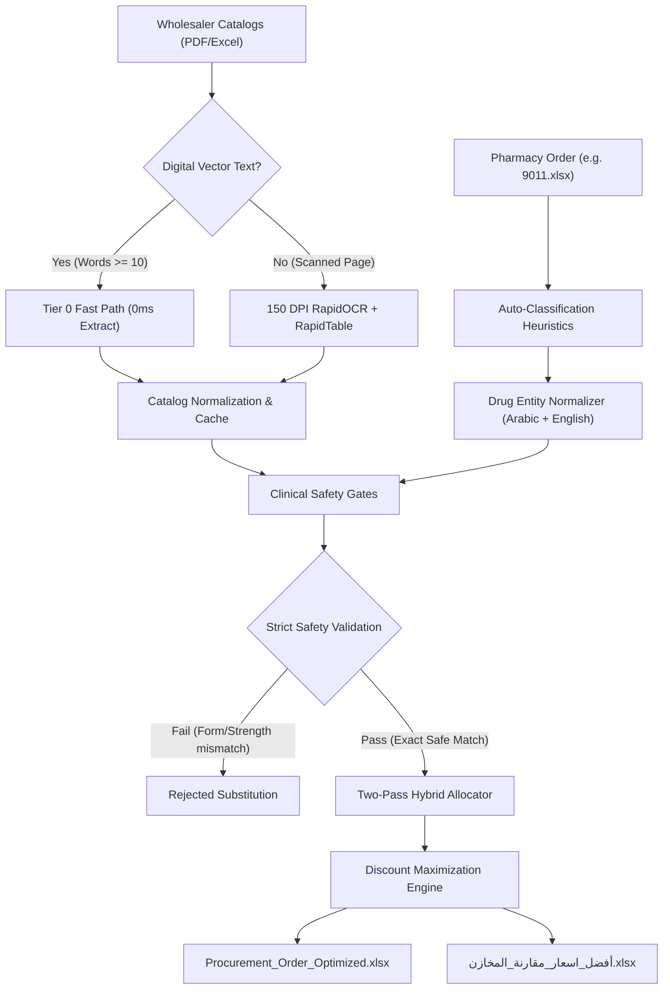

# 🏥 Egyptian Pharma Procurement Optimizer (نظام المشتريات الصيدلانية الأمثل)
**Version:** 1.9 (Production Windows Release)  
**Platform:** Windows 10 / 11 (64-bit) & Cross-Platform Python  

An intelligent, automated procurement optimization desktop application designed specifically for Egyptian community and hospital pharmacies. It ingests daily pharmaceutical wholesaler price lists (PDF and Excel catalogs), matches medicine orders with strict clinical safety validation, maximizes commercial discounts per item, and generates professionally formatted Arabic Excel purchase orders (`أفضل_اسعار_YYYY-MM-DD.xlsx` and `Procurement_Order_Optimized_YYYY-MM-DD.xlsx`).

---

## 🌟 What's New in Version 1.9

- 📊 **Per-Warehouse Above-Average Discounts Secondary Table**: Injects a secondary table directly into each supplier's purchase order sheet (`طلب شراء - [اسم المخزن]`) listing all products available from that supplier saving `>= 4.00 EGP` per pack compared to the reference weighted average discount.
- 🎨 **Visual Price Status Highlighting (Soft Green & Soft Yellow)**: Highlights Column 8 (`المخزن صاحب أعلى خصم`) in Soft Green (`#E2EFDA`) if the warehouse offers the highest catalog discount across all suppliers, and Soft Yellow (`#FFF2CC`) displaying the winning warehouse and rate if another warehouse offers a higher discount.
- 🧹 **Clean Workbook Layout**: Removed the standalone sheet `أصناف بخصم أعلى من المرجح` in favor of per-supplier integrated tables.
- 📦 **Windows Installer v1.9**: Pre-compiled standalone setup package (`EgyptianPharmaOptimizer_Setup_v1.9.exe`) with auto-upgrades and shortcuts.

---

## 🚀 Quick Start & Installation

### Option 1: Standalone Windows Installer (Recommended)
1. Download or locate the setup file:
   ```text
   dist_installer/EgyptianPharmaOptimizer_Setup_v1.9.exe
   ```
2. Double-click to install. It creates a desktop shortcut and Start Menu entry.
3. No Python, C++ runtimes, or external AI models need to be installed.

### Option 2: Portable Executable
Run the pre-compiled executable directly without installation:
```text
dist/EgyptianPharmaOptimizer/EgyptianPharmaOptimizer.exe
```

### Option 3: Run from Source (Developers)
```bash
# 1. Clone or open the repository
cd Inventory-search

# 2. Install dependencies
pip install -r requirements.txt

# 3. Launch GUI
python app_gui.py
# Or double-click: تشغيل_البرنامج.bat
```

---

## ⚡ Core Architecture



### 1. Catalog Ingestion & Hybrid OCR
- **Tier 0 Fast Path**: Extracts words, bounding boxes, and tabular structures directly from vector PDFs using PyMuPDF in milliseconds.
- **Resilient OCR Fallback**: For scanned price sheets or faxed catalogs, RapidTable and RapidOCR operate at an optimized 150 DPI resolution with non-degradation guarantees (digital and OCR items are merged, never overwritten with empty data).
- **Catalog Noise Suppression**: Filters out wholesaler telephone numbers, contact footers, and disclaimer blocks (`is_catalog_noise`).

### 2. Strict Clinical Safety Gates (`src/pharma_matcher.py`)
Every match must strictly satisfy four non-negotiable safety criteria:
1. **Exact Dosage Form Category**: Tablets/Capsules $\ne$ Syrups $\ne$ Injections $\ne$ Creams/Ointments.
2. **Exact Strength & Concentration**: `500mg` $\ne$ `1000mg`, `10/160` $\ne$ `10/320`.
3. **Formulation Modifiers**: Plain $\ne$ `Extra` $\ne$ `XR/SR` $\ne$ `Plus` $\ne$ `Cold & Flu`.
4. **Pediatric & Infant Milks**: Stage 1 $\ne$ Stage 2 $\ne$ Stage 3.

### 3. Allocation & Arabic Report Generation
- Computes best pricing across all available wholesalers based on `max(discount_rate)`.
- Produces clean, multi-sheet Arabic workbooks with:
  - **Executive KPI Dashboard**: Total items, matched items, out-of-stock count, total savings (EGP), and average discount %.
  - **Supplier Purchase Orders**: Individual sheets for each wholesaler (`طلب_اسم_المخزن`) with quantities, prices, and net totals ready for sending.
  - **Shortages / Out of Stock (`النواقص`)**: Dedicated sheet listing items not found across any supplier.

---

## 📁 Repository Structure

```text
Inventory-search/
├── app_gui.py, main.py                  <-- Application entry points
├── تشغيل_البرنامج.bat                   <-- Windows source launcher
├── src/                                 <-- Application modules
├── assets/                              <-- Icons and packaged resources
├── input/                               <-- Orders and supplier catalogs
├── output/                              <-- Generated procurement reports
├── test1/, train/                       <-- Sample and benchmark data
├── tests/                               <-- Automated tests
├── diagnostics/, scripts/               <-- Developer tools
├── scratch/                             <-- Temporary investigation artifacts
├── archive/                             <-- Older backups and archived distribution
├── docs/current/                        <-- Current project documentation
├── docs/PROJECT_LAYOUT.md               <-- Folder organization guide
├── CHANGELOG.md                         <-- Release history
└── README.md                            <-- Project overview
```

See [`docs/PROJECT_LAYOUT.md`](docs/PROJECT_LAYOUT.md) for the full explanation of current, archived, and generated folders.

---

## 🧪 Testing & Verification

Run the full automated test suite (197 tests):
```bash
python -m pytest tests/ -v
```

Run v1.1.4 specific verification tests:
```bash
python -m pytest tests/test_v114_fixes.py -v
```

Run headless application self-test:
```bash
python app_gui.py --self-test
```

---

## 🛠️ Building the Standalone Application

To rebuild the `.exe` and `.exe` installer from source:
```bash
# 1. Compile with PyInstaller
python build_exe.py

# 2. Compile Inno Setup installer
& "C:\Users\<username>\AppData\Local\Programs\Inno Setup 6\ISCC.exe" installer.iss
```
Output setup will be placed in `dist_installer/EgyptianPharmaOptimizer_Setup_v1.9.exe`.

